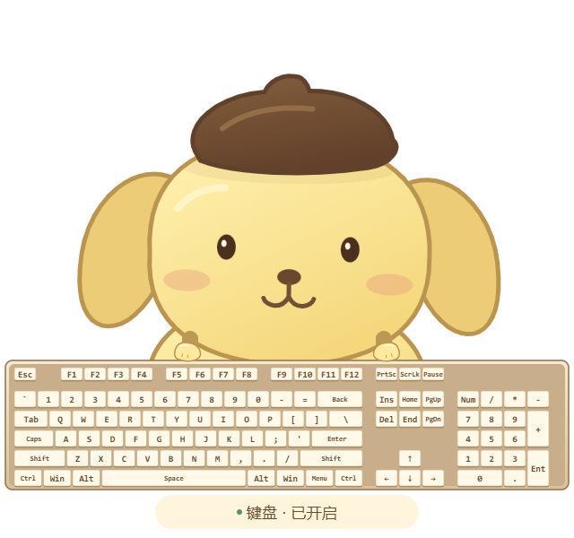
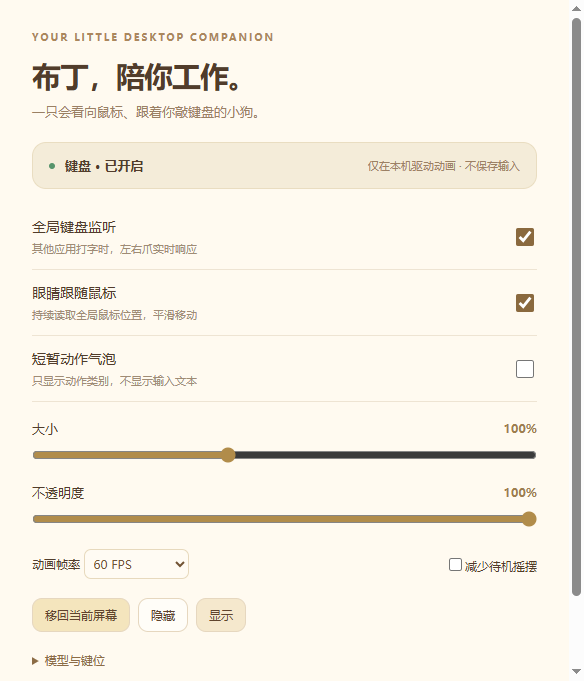

# 布丁狗桌面宠物 🐾

一个 Windows 透明桌面宠物原型：布丁狗风格的小狗会看向全局鼠标，并跟着键盘输入，把左右爪放到对应键位上。

当前版本 **0.2.0**。基于 [chiikawa-pets](https://github.com/meiguiyisenluo/chiikawa-pets) 的 Electron / Vite / React 框架与 Win32 全局事件桥改造，保留 MIT 许可证及归属说明。角色是可替换的分层 SVG 原型，非 Sanrio 官方模型。

## 效果图

| 待机与完整 104 键 | A / J 对应左右爪 |
| --- | --- |
|  |  |

第二张图使用受控动画事件演示 A/J 同时按下时的定位效果，不代表物理键盘的完整验收记录。

<details>
<summary>设置面板</summary>



</details>

## 功能

- 真透明、无边框、置顶窗口，桌宠窗口不可获取键盘焦点；按角色和键盘遮罩切换鼠标穿透。
- Win32 全局键盘监听，其他应用处于前台时也能收到按下/松开事件，支持独立关闭监听。
- 完整 ANSI/QWERTY 104 键：字母、数字、F1–F12、左右修饰键、导航、方向及数字区。
- 当前按键即时高亮，左右爪在约 75ms 内平滑移向对应键帽；连续输入保留当前位置与敲击相位。
- 支持组合键、双爪空格、松开恢复，以及锁屏/休眠/禁用时清理动画状态。
- 持续读取全局鼠标坐标，眼睛平滑跟随，配合眨眼、呼吸与轻微摇摆。
- 托盘菜单、拖动、缩放、透明度、隐藏/显示、退出，动画可选 30/60 FPS。

默认窗口为 640×600，逻辑素材画布为 320×300。可从托盘调整大小。只有当前按住状态和短暂高亮保存在内存中，不保存输入历史。

## 开发与运行

环境：**Windows 10/11 x64、Node.js 22.12+**，本次构建使用 Node.js 24.22.1。

```bash
git clone https://github.com/wuseir/pompompurin-pet.git
cd pompompurin-pet
npm ci
npm run dev
```

构建后直接运行：

```bash
npm run build
npm start
```

Electron 的依赖安装会下载运行时；原生 hook 使用 npm 包自带的 x64 `.node` 文件。本次构建没有安装 Rust、Visual Studio 或驱动。若所在环境禁止 npm postinstall，可按环境允许的方式运行 `node node_modules/electron/install.js`，不要关闭证书校验。

## 生成 Windows 便携版

当前仓库提供源码和效果图。便携版通过以下命令本地生成：

```bash
npm run package:win
```

输出位于 `release/0.2.0/`：

```text
PuddingPet-win32-x64/             # 双击其中的 PuddingPet.exe
PuddingPet-0.2.0-win32-x64.zip
PuddingPet-0.2.0-source.zip
manifest.json
SHA256SUMS.txt
```

必须保留整个便携目录的 DLL、resources、locales 和许可证；运行便携版不需要 Node.js 或网络。已有同版本产物时，打包命令会停止以保留旧文件，重新打包前请先移动旧产物。当前没有安装器、自动启动或自动更新。

## 配置与自定义模型

配置在 `%APPDATA%\PuddingPet`，与发布目录分开：

```text
settings.json       # 开关、位置、大小、透明度、帧率
keymap.json         # 静态 VK 到动作映射，不是按键记录
models/custom/      # 可选的自定义角色图层
```

右键角色或托盘进入设置。`keymap.json` 的键为十进制 Windows 虚拟键码，值的 `action` 为 `left/right/both/none`，例如：

```json
{
  "65": { "action": "left", "kind": "tap" },
  "74": { "action": "right", "kind": "tap" },
  "32": { "action": "both", "kind": "space" }
}
```

用户配置覆盖默认映射；显式 `action: "none"` 可忽略某键。保存后在设置中点击“重新加载”。

替换角色时，将 `public/models/prototype` 作为模板，准备 `model.json`、`body.svg`、`left-paw.svg`、`right-paw.svg`、`keyboard.svg`，放入 `models/custom/`。图层使用统一的 320×300 透明画布，SVG 或透明 PNG 均可。眼球由 renderer 独立绘制，位置与位移范围在 `model.json` 配置。完整文件约定见 [模型模板说明](public/models/README.txt)。

104 键由 [`shared/keyboard-layout.ts`](shared/keyboard-layout.ts) 统一定义，键帽绘制、爪定位、静态 SVG 和测试共用同一套坐标。角色模型中的 `keyboard.svg` 保留为静态导出契约，换角色不会改变实际键位。

当前不加载 Live2D。以后接入需准备有使用授权的 `.model3.json`、`.moc3`、纹理及眼球/眼睑/左右爪参数，并单独核对 Cubism SDK 许可。

## 验证与限制

```bash
npm test
npm run build
npm run test:keyboard
npm run test:desktop
```

已执行的 0.2.0 验证：

- 16 项逻辑测试通过，覆盖布局、A–Z 定位、连续运动、组合键、空格、恢复、视线与配置校验。
- 开发版和发布 EXE 的逐键界面检查通过：104 个键帽、26 个字母的目标坐标/高亮、A/J 同时定位、松开恢复。
- 发布 EXE 的 8 项桌面冒烟检查通过，包括透明像素、不可获取焦点/置顶属性、监听进程开关、缩放、隐藏/显示和无 renderer error。

逐键界面检查使用受控 IPC 事件。物理键盘在浏览器/编辑器中的完整输入、实际点击穿透和拖动、多 DPI 多屏、锁屏恢复及长时间稳定性仍需人工验收。测试通过不等于所有桌面场景已验收。详见 [0.2.0 验证说明](docs/keyboard-0.2.md) 和 [初版验证记录](docs/validation.md)。

原生接口只返回 VK，无法区分主 Enter 和小键盘 Enter，两处会同时高亮，爪默认指主 Enter；NumLock 关闭后的数字区导航键也存在类似限制。无重复事件的长按状态会在 1.6 秒后过期。Electron 多进程有固定内存开销，当前没有完成长期资源压力测试。便携版未签名，不绕过系统或组织的运行限制。

## 输入隐私

只读取驱动动画所需的按下、松开、VK 和全局鼠标坐标；不读取实际文本、剪贴板或其他应用内容。不保存逐键历史，不添加按键统计、遥测或键盘数据网络发送。事件放行给后续系统处理，不模拟、吞掉或拦截用户输入。运行包无远程脚本或更新器，会话层阻止 HTTP/HTTPS/WS/WSS 请求。

## 开源与角色归属

代码遵循 [MIT License](LICENSE)，保留原项目与原生输入模块的版权声明。依赖与来源见 [THIRD_PARTY_NOTICES.md](THIRD_PARTY_NOTICES.md)、[选型记录](docs/research.md) 与 [上游来源清单](docs/upstream-origin.json)。`upstream/chiikawa-pets` 为原始文本源码参考快照，不参与应用构建。

Pompompurin / 布丁狗角色权益属于 Sanrio。仓库包含本项目编写的非官方 SVG 风格原型及其界面效果图，不是官方授权模型；MIT 代码许可证不授予 Sanrio 角色、商标或第三方素材的使用/再分发权。角色素材与应用代码的许可应分别确认。
